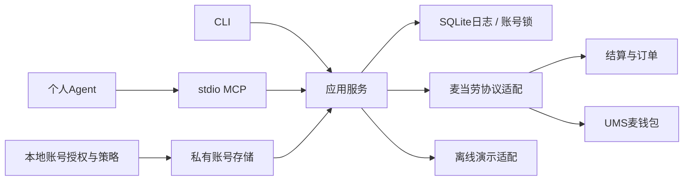

# 架构与执行约束

CLI与MCP共享`Service`，额度和去重不依赖客户端是否遵守工具描述。

## 账号与协议

`accounts/<identity>.json`保存官方会员凭据、协议构建、运行字段和策略。identity由会员标识派生，更新sid不改变日志范围，别名和真实身份都唯一。

v4/v5及钱包签名从真实联调实现提取，改为显式账号参数，避免全局账号混用。本地历史原型用于对照，不进入公开仓库。SDK常量从用户自己的官方App二进制读取，哈希变化即停止。v5样本必须绑定当前sid和deviceToken，且不超过24小时；这是本适配器限制，不是官方保证有效期。

本地短信登录仅选择已授权官方上下文中的设备字段，不携带旧sid或会员身份。手机号与验证码按该构建的AES-128-ECB/PKCS7十六进制协议加密；材料来自本机二进制。手机号绑定、现有会员和钱包只读核验通过后才登记账号，同身份保留策略和日志，不复制旧v5运行字段。请求前持久化尝试，未知结果与验证码提交均不自动重试，额外官方验证单独返回。

## 状态与执行

会话维护使用同一账号锁：`CLAIMED → CANDIDATE → REFRESHED`。执行记录与候选凭据保存在账号私有文件，核验后一次原子写入提交会话及完成状态。响应未知或被拒绝时禁止重发；候选会话已保存时只恢复余额核验。`sid` 更换清除旧运行样本，策略和订单日志保持原身份范围。详见[会话维护](session-maintenance.md)。

`RESERVED → CREATED → PAYMENT_ATTEMPTED → PAID`。网络、解析或状态不确定时进入`UNKNOWN`，只查询；订单取消时进入`CANCELLED`。每个已发送阶段都有不可重入的`(attempt, stage)`记录。

1. 持有真实账号锁，读取报价及策略，查询幂等键和内容指纹。
2. 检查报价未过期，重新结算逐字段比较，并查询服务端同店同取餐时间的未取消订单。
3. SQLite事务内预留本工具预算和数量；写请求发送前提交日志。
4. 下单，绑定orderId/payId，核对实际商品、组件、数量、金额和取餐安排。
5. 预支付取得bizSeqNo，**之后**获取钱包token，再消费一次。
6. 核对订单、收银台和余额。未知状态不能触发写重试。

所有预留尝试保守计入预算，失败/取消不自动释放。外部App并发操作不受本工具锁控制，服务端已有订单检查也不是跨客户端事务锁，不能声称绝对恰好一次。

## 商品

支持已配置官方购物车中的type=1普通商品、type=7套餐，多行、多份。菜单递归读取；卡券标识只留在私有协议数据。预约、取餐柜、组件、uniqueKey、金额和优惠必须一致。

`product_detail`读取实时轮次与选项，`cart_add_configured`按明确选择组装单品或套餐，使用当次权益卡字段；仅支持标准组件及已验证默认配料结构。`cart_add_simple`兼容无规格和活动的单品。高级定制仍由官方App配置。未建模的费用或整单优惠停止，不推测金额。

购物车检查生成身份及门店/时段绑定的120秒引用，数据库只保存范围与完整车内容指纹。`cart_clear` 重新核对内容，再以事务绑定一次性引用、幂等键和写日志；重复调用只查询当前车，不重发清空。外部 App 并发不受本地锁保护。[购物车行为](cart.md)。

## 数据与传输

- HTTPS固定域名和方法/路径白名单，正常证书校验，无重定向或重试。
- 会话、完整预支付返回和token仅在本机私有状态或内存中，不返回MCP。
- SQLite参数化查询、FULL同步，POSIX flock适用于单机用户，不是分布式锁。
- 原始写响应保存在0600数据库，公共输出只给有限状态和订单摘要。
- 演示适配器不创建HTTP客户端，身份与真实账号隔离。

HTTP托管、多设备共享或跨用户部署需要单独设计认证、租户隔离、密钥存储及分布式执行；不可把stdio进程直接公开。
